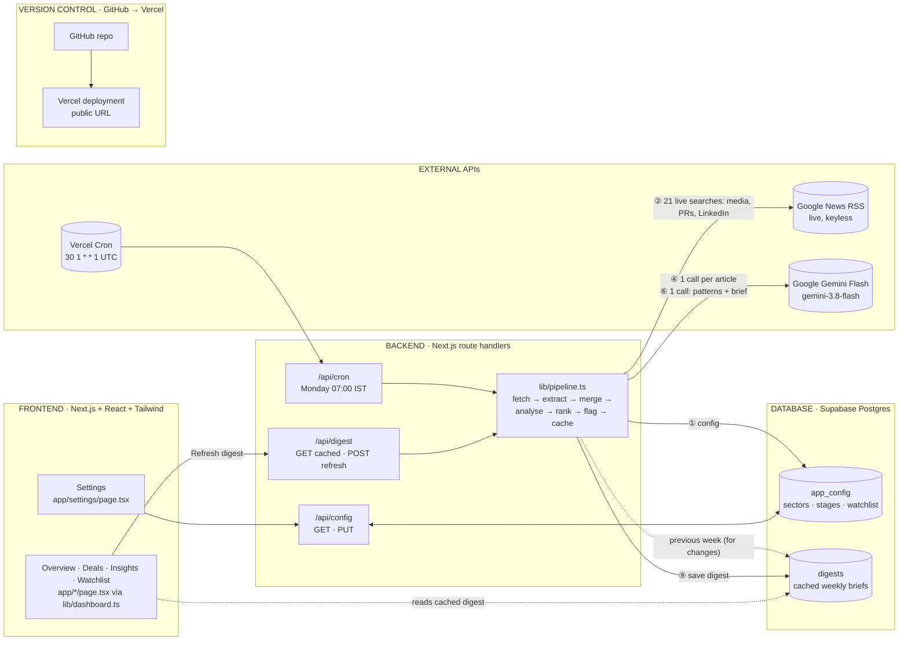

# Startup Funding Pulse: Components Map

A weekly Indian startup-funding intelligence digest for Aarav, a venture scout. It reads the
last 7 days of live funding news, extracts structured deals with **Google Gemini Flash**, ranks
his focus sectors and stages first, detects patterns, and flags watchlist companies.

> **AI provider: Google Gemini Flash only** (`gemini-3.8-flash` via `@google/genai`).
> No other AI provider is used anywhere in the codebase.

---

## 1. The five components

| Layer | Technology | What it does in this app | Where it lives |
|---|---|---|---|
| **Frontend** | Next.js 15 (App Router) · React 19 · Tailwind CSS 4 | A five-tab venture-intelligence dashboard. **Overview**: KPIs, priority alerts, compact brief, sector/stage charts, top mandate matches. **Deals**: searchable, sortable, filterable explorer with a detail drawer. **Insights**: full AI brief (observed facts kept separate from Gemini's interpretation) plus sector, stage, weekly-trend and momentum analytics. **Watchlist**: tracked companies, watchlist/adjacency alerts. **Settings**: mandate editor. Header has a **week picker / "time machine"** (last 8 Monday–Sunday weeks; open stored weeks, build missing ones on demand), a **"this week so far"** view (Monday → now, kept separate from full-week comparisons), and an Up to date / In progress / Archive / Stale indicator. Dark by default, light optional, responsive. | `app/{page,deals,insights,watchlist,settings}`, `components/*`, `components/charts/*`, `components/deals/*` |
| **Backend** | Next.js route handlers (Node.js, server-only) | Runs the data pipeline: fetch → extract → merge → drop follow-up coverage → analyse → rank → flag → cache. Serves the digest and config; runs the weekly cron; builds past weeks and week-to-date on demand. | `app/api/digest`, `app/api/config`, `app/api/news`, `app/api/cron`, `app/api/weeks`, `lib/pipeline.ts`, `lib/*` |
| **Database** | Supabase (Postgres) | `app_config`: Aarav's editable settings (one row). `digests`: each generated weekly brief as JSON, so the page loads instantly and falls back to the last good brief if a live run fails. Row-Level Security on, server-only access. | `supabase/schema.sql`, `lib/supabase.ts`, `lib/config.ts`, `lib/cache.ts` |
| **APIs** | Google News RSS (live data, keyless) · Google Gemini Flash API · Supabase REST · Vercel Cron | News in, AI extraction and analysis, storage, and the Monday trigger. See section 4 for exactly where each one is called. | `lib/news/rss.ts`, `lib/gemini/*`, `lib/cache.ts`, `vercel.json` |
| **Version control & hosting** | Git + GitHub · deployed on Vercel | Source of truth for the code; Vercel builds from the GitHub repo and hosts the public URL and the cron job. Secrets live only in `.env.local` (git-ignored) and Vercel environment variables. | `.gitignore`, `.env.example`, `vercel.json` |

---

## 2. Architecture diagram

Circled numbers on the arrows match the steps in section 3.

---

## 3. Data flow: from live news to the rendered brief

**Reporting week = Monday 00:00 → Sunday 23:59 IST** (the brief asks for "the previous week" every Monday).
Every run goes through `runPipeline()` in `lib/pipeline.ts`: the Monday 07:00 IST cron and **Refresh** build the latest
full week; the week picker builds an older week (archive) or **this week so far** (Monday → now):

| # | Step | Code | External call? | Output |
|---|---|---|---|---|
| 1 | **Load config**: focus sectors, focus stages, watchlist | `lib/config.ts → getConfig()` | Supabase `app_config` (falls back to `config/default-config.json`) | `AppConfig` |
| 2 | **Fetch live news** for the week's date range: 6 broad queries, 8 **channel** queries (startup media: Entrackr, Inc42, YourStory, VCCircle; press releases: PR Newswire; financial press: ET, Business Standard; founder/investor **LinkedIn** posts as indexed by Google News) and 1 per focus sector. India-only, in parallel, 8 s timeout each | `lib/news/rss.ts → fetchQuery()` | **Google News RSS** | ~1,100 raw articles `{title, snippet, url, source, publishedDate}` |
| 3 | **Filter & de-duplicate**: keep the 7-day window, keep funding-related headlines, drop noise (IPOs, layoffs, roundups), merge repeats by URL / near-identical headline / same company | `lib/news/filter.ts`, `lib/news/index.ts` | – | ~85 candidate articles |
| 4 | **Extract with Gemini Flash**: **one call per article**, 10 in parallel, strict JSON schema | `lib/gemini/extract.ts → extractDeal()` | **Gemini Flash** × N | Per article: `isFundingEvent, isIndian, company, sector, subSector, stage, amount, amountUsdM, leadInvestor, otherInvestors, city, date, oneLineSummary` (+ `sourceUrl` from the real article, never from AI) |
| 5 | **Merge duplicates**: same company reported by several outlets becomes one deal with "also reported by". Then **drop follow-up coverage**: rounds already in the previous week's brief (same company, similar amount) are excluded and listed in the run notes | `lib/merge.ts → mergeDeals(), excludePreviouslyReported()` | – | ~35 unique new deals |
| 6 | **Week analysis with Gemini Flash**: **one call** over all deals: consistent sectors/stages mapped to Aarav's focus names, same-deal-different-name detection, 2–4 patterns each backed by ≥ 2 real deals, and the **weekly brief** (executive summary, investor read, follow-ups). Every company/investor Gemini names is checked against the real deal list; anything ungrounded is dropped. Week-over-week numbers are **not** asked of Gemini; they're computed in code (step 10) so they're exact. | `lib/gemini/analyze.ts → analyzeWeek()`, `lib/history.ts` | **Gemini Flash** × 1 | `patterns[]`, `brief`, normalised `sector`/`stage`, `sameAs` |
| 7 | **Rank**: Tier 1 = focus sector **and** stage, Tier 2 = either, Tier 3 = rest; then by size, then by date | `lib/rank.ts → matchConfig(), rankDeals()` | – (plain code) | Ranked `Deal[]` |
| 8 | **Flag watchlist**: whole-word, case-insensitive match on company, investors, or headline | `lib/watchlist.ts → findWatchlistMatch()` | – (plain code) | `watchlistMatch` per deal |
| 9 | **Cache** the finished digest | `lib/cache.ts → saveDigest()` | Supabase `digests` | Row with JSON payload |
| 10 | **Render**: `getDashboard()` (one load per request) reads the latest cached digest and stored weekly history, **re-applies ranking + watchlist with the current settings** (so Settings edits show instantly, no AI needed), computes observed facts, alerts, stage/sector breakdowns, **week-over-week changes**, **new investors in target sectors** (not seen in earlier stored weeks) and freshness in plain code, and renders the five tabs. Comparisons render only when a previous full week is stored, and never for a week in progress. | `lib/dashboard.ts`, `lib/insights.ts`, `lib/alerts.ts`, `lib/freshness.ts`, `app/*`, `components/*` | Supabase `digests` + `app_config` | The dashboard |

---

## 4. Exactly where each external API is called

| API | Called from (file → function) | When | Auth | If it fails |
|---|---|---|---|---|
| **Google News RSS** `news.google.com/rss/search` | `lib/news/rss.ts → fetchQuery()` (via `lib/news/index.ts → fetchWeeklyNews()`) | Every pipeline run; also `GET /api/news` (raw feed for inspection) | None (keyless) | Each query fails independently; partial results continue with a note. If **all** fail, the page shows the last cached digest with a warning. |
| **Google Gemini Flash**: extraction | `lib/gemini/extract.ts → extractDeal()` | Once **per article**, every pipeline run | `GEMINI_API_KEY` (server env) | Bad JSON → retry once, then skip that article (logged, counted in "couldn't be parsed"). Rate limit/overload → back off and retry. If **every** article fails → fall back to cached digest. |
| **Google Gemini Flash**: week analysis + brief | `lib/gemini/analyze.ts → analyzeWeek()` | Once per pipeline run | `GEMINI_API_KEY` | Retry once / back off; if it still fails, deals and observed facts still show, and the brief/patterns sections say they were unavailable. |
| **Supabase**: config | `lib/config.ts → getConfig(), saveConfig()` | Page loads, Settings saves, each pipeline run | `SUPABASE_SERVICE_ROLE_KEY` (server only) | Read → falls back to `config/default-config.json` with a notice. Save → clear error on the Settings page. |
| **Supabase**: digest cache | `lib/cache.ts → saveDigest(), getLatestDigest()` | End of each run; every page load | `SUPABASE_SERVICE_ROLE_KEY` | Save failure → digest still shown, with a note. Read failure → generate live. |
| **Vercel Cron** | Calls `app/api/cron/route.ts → GET` | Mondays 01:30 UTC = **07:00 IST** (`vercel.json`), building the Mon–Sun week just ended | `Authorization: Bearer CRON_SECRET` | 500 + log; last week's brief stays live, and the first visit after a missed run builds it. |

The browser never talks to Gemini, Google News or Supabase directly. Every external call happens
on the server, so no key is ever sent to the client.

---

## 5. Config-driven (Aarav edits this himself)

| Setting | Effect | Edited in |
|---|---|---|
| **Focus sectors** (e.g. Fintech, Climate, SaaS, AI) | Rank deals to the top and add one news search per sector | **Settings page** → saved to Supabase `app_config` |
| **Focus stages** (e.g. Seed, Series A) | Rank deals to the top | Settings page |
| **Watchlist companies** | Flag any announcement involving them (as company, investor, or in the headline) | Settings page |

Fallback when no database is connected: `config/default-config.json` (one clearly editable file).
No app logic needs to change to update any of these.

---

## 6. Edge cases handled

| Situation | What Aarav sees |
|---|---|
| All news searches fail | Last saved brief + amber "Live news fetch failed…" banner |
| Some searches fail | Brief renders; note "3 of 13 news searches failed" |
| No funding news this week | Intentional empty state explaining which sources were checked |
| No deals in focus sectors/stages | "No deals matched your focus…" with link to Settings; all deals still listed |
| Gemini returns malformed JSON | Retried once, then that article is skipped and counted |
| Gemini unavailable / bad key | Last saved brief + banner; nothing crashes |
| Pattern analysis / brief fails | Deals and observed facts shown; brief sections say they were unavailable |
| Brief older than the feature | "Generated before the AI brief existed, use Refresh" |
| Only one reporting week stored | KPI deltas hidden; trend and momentum panels explain they need a second week (nothing extrapolated); the week picker can build earlier weeks |
| Viewing this week so far | Blue "in progress" strip on every tab; no comparisons against full weeks |
| Viewing an older week | Amber "Viewing archive" strip on every tab with "Back to latest week" |
| Same deal re-reported the following week | Excluded as follow-up coverage and named in the run notes |
| Digest older than 7 days / live refresh failed | Header indicator turns **Stale** with the reason on hover |
| Filters match no deals | "No deals match these filters" with Clear filters |
| Undisclosed amount / stage / lead, or sector "Other" | Shown as such; the deal drawer lists data-quality notes |
| Duplicate stories / same deal under two names | Merged into one card listing the other outlets |
| Missing amount / investor | Shown as "Undisclosed", never invented |
| No saved brief yet | "No digest yet" card with a Generate button |
| Unexpected error | `app/error.tsx` card with Try again, never a blank screen |

---

## 7. Security

- Keys (`GEMINI_API_KEY`, `SUPABASE_URL`, `SUPABASE_ANON_KEY`, `SUPABASE_SERVICE_ROLE_KEY`, `CRON_SECRET`) live only in `.env.local` locally and in Vercel environment variables in production.
- `.env*` is git-ignored (except the placeholder-only `.env.example`).
- Supabase tables have Row-Level Security enabled with no public policies, so the public anon key can't read or write them; only the server (service role) can.
- `/api/cron` requires the `CRON_SECRET` bearer token.
